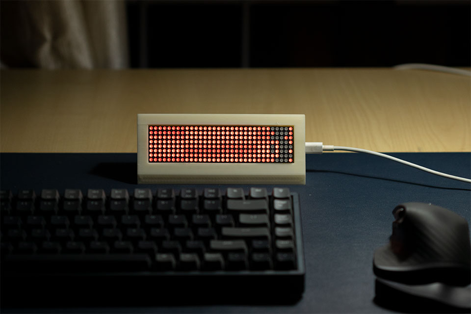
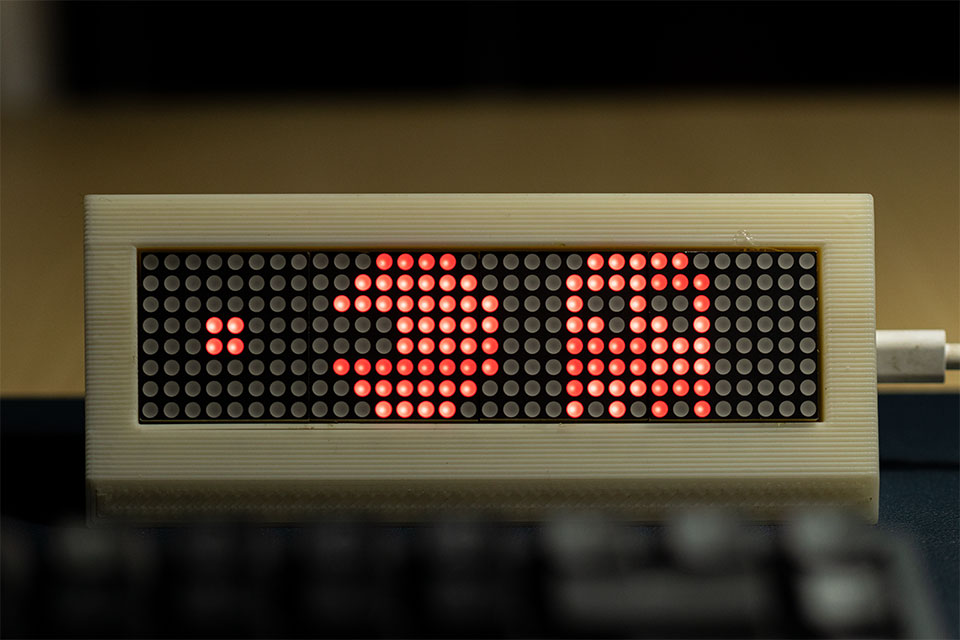
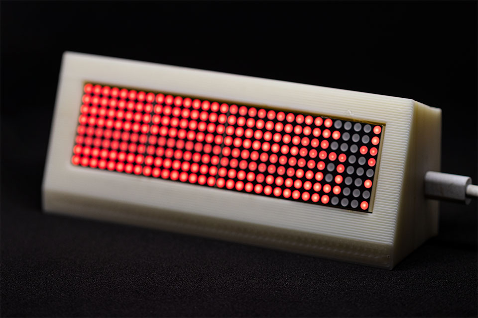
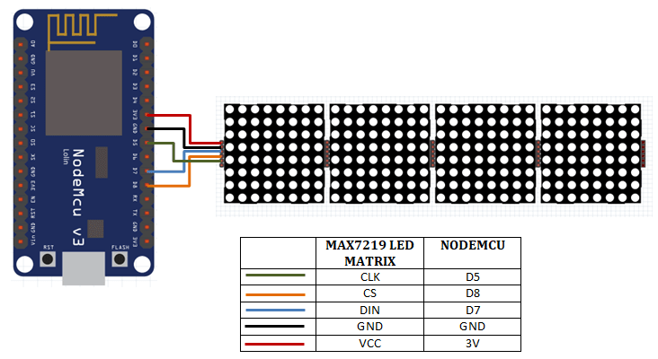
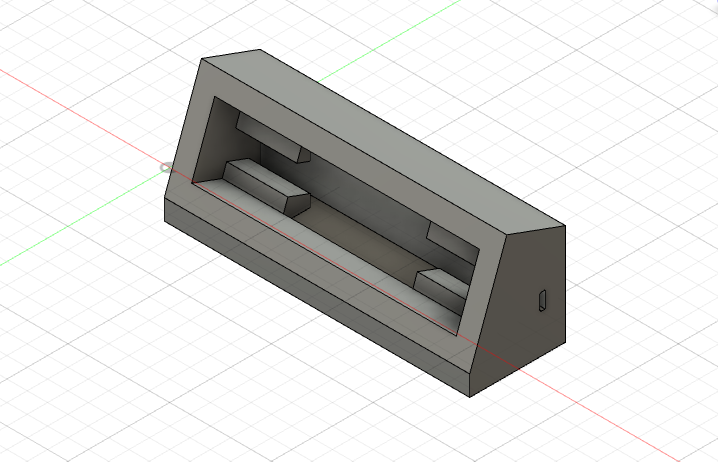
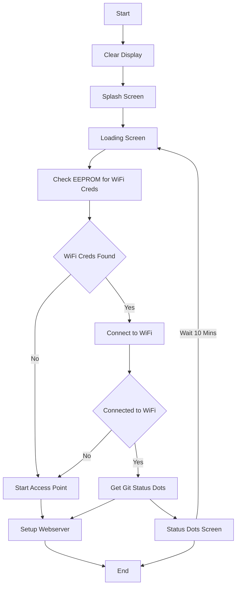

# Git Status Display



ESP8266 device that shows your GitHub contribution calendar on a 4x MAX7219 LED matrix.

## Hardware

- ESP8266 (ESP-12E)
- 4x MAX7219 LED matrix modules (32×8 total)
- See wiring diagram below

## Setup

### 1. Flash firmware

```sh
pio run --target upload
```

### 2. Configure WiFi

Device starts as access point **Git Device** with password **123456789**.

Connect to it, browse to **192.168.0.1**, enter your WiFi credentials.

Device restarts and connects to WiFi.

### 3. Configure GitHub

Find device IP (router admin page or IP scanner).

| Endpoint    | Purpose               |
|-------------|-----------------------|
| `/token`    | Set GitHub API token  |
| `/username` | Set GitHub username   |
| `/creds`    | Update WiFi creds     |

### Getting a token

Generate at [github.com/settings/tokens](https://github.com/settings/tokens)

Required permission: **`read:user`** only.

> Both classic (40 chars) and fine-grained (up to 93 chars) tokens supported.

## Resetting the device

To reset WiFi credentials, wipe EEPROM by re-flashing or submitting blank credentials via `/creds`.

> `/reset` endpoint is not implemented — use `/creds` to reconfigure.





## Wiring



| ESP8266 | MAX7219 |
|---------|---------|
| D5      | CLK     |
| D7      | DATA    |
| D8      | CS      |

## Enclosure



3D files in `/Enclosure`. Slice and print.

## Flow Chart


